<div class="ctf-hero">

  <h1>The Hollow Shell</h1>

  <p>
    A technical investigation of the Byte Lotus Shoreline Display portal,
    demonstrating how unsafe ZIP extraction and an insufficiently isolated
    background worker can combine to create a remote-code-execution path.
  </p>

  <div class="ctf-badges">
    <span class="ctf-badge">TryHackMe</span>
    <span class="ctf-badge">Hacker Holidays 2026</span>
    <span class="ctf-badge">Day 10</span>
    <span class="ctf-badge">Medium</span>
    <span class="ctf-badge">Web Security</span>
    <span class="ctf-badge">Zip Slip</span>
    <span class="ctf-badge">Linux</span>
  </div>

</div>


## Navigation

<div class="ctf-toc">
<div class="ctf-toc-title">Documentation Map</div>
<ul>
<li><a href="#mission">Mission and Executive Summary</a></li>
<li><a href="#quick-overview">Quick Overview</a></li>
<li><a href="#target-information">Target and Lab Information</a></li>
<li><a href="#attack-path">Attack Path</a></li>
<li><a href="#evidence-gallery">Evidence Gallery</a></li>
<li><a href="#room-overview">Room Overview</a></li>
<li><a href="#reconnaissance">Reconnaissance</a></li>
<li><a href="#upload-endpoint">Upload Endpoint Discovery</a></li>
<li><a href="#source-disclosure">Source Disclosure</a></li>
<li><a href="#dashboard-enumeration">Dashboard Enumeration</a></li>
<li><a href="#baseline-upload">Baseline Upload</a></li>
<li><a href="#zip-slip">Zip Slip Discovery</a></li>
<li><a href="#arbitrary-file-write">Arbitrary File Write</a></li>
<li><a href="#worker-hook">Worker Hook Analysis</a></li>
<li><a href="#payload-archive">Payload Archive</a></li>
<li><a href="#shell-and-objective">Shell Access and Objective</a></li>
<li><a href="#technical-analysis">Technical Analysis</a></li>
<li><a href="#exploitation-chain">Exploitation Chain</a></li>
<li><a href="#methodology">Investigation Methodology</a></li>
<li><a href="#root-cause">Root Cause Analysis</a></li>
<li><a href="#security-findings">Security Findings and Impact</a></li>
<li><a href="#remediation">Security Recommendations</a></li>
<li><a href="#detection">Detection Opportunities</a></li>
<li><a href="#lessons-learned">Lessons Learned</a></li>
<li><a href="#skills-and-tools">Skills and Tools</a></li>
<li><a href="#repository-structure">Evidence and Repository Structure</a></li>
<li><a href="#related-documentation">Related Documentation</a></li>
<li><a href="#flag-policy">Flag Policy</a></li>
<li><a href="#responsible-use">Responsible Use</a></li>
<li><a href="#references">References</a></li>
</ul>
</div>

---

## Mission and Executive Summary

<a id="mission"></a>

The objective of **The Hollow Shell** is to investigate a web application that accepts uploaded ZIP-based shell packages and identify a path to the challenge flag.

The documented investigation follows a chain of weaknesses involving client-side source disclosure, unsafe archive extraction, arbitrary file writing, and a background worker that processes automation hooks.

The application initially presents a conventional upload workflow. However, the investigation establishes that archive member paths are not adequately constrained to the intended extraction directory. This creates a Zip Slip vulnerability that can be used to write files outside the expected location.

The dashboard's reference to automation hooks and a theme worker reveals a potential trust-boundary issue: files written through the upload mechanism may reach a trusted automated consumer.

The documented exploitation sequence culminates in shell access as `roomservice`. The final flag remains intentionally redacted.

### Investigation objectives

- Enumerate the exposed network services.
- Identify the web application's upload endpoint and supported HTTP method.
- Inspect client-delivered source for information disclosure.
- Understand the authenticated shell-upload workflow.
- Investigate ZIP extraction behavior and validate path traversal.
- Establish arbitrary file write through controlled evidence.
- Analyze the relationship between filesystem writes and background-worker processing.
- Document the resulting shell context and challenge objective.
- Explain the root cause, impact, detection opportunities, and defensive controls.

### Key finding

<div class="key-finding">
  <div class="key-finding-title">Primary Security Finding</div>

  Insufficient validation of archive member paths allows ZIP extraction to escape its intended directory. When this file-write primitive intersects with a trusted worker that processes attacker-influenced content, the impact can escalate from arbitrary file placement to code execution.
</div>

## Quick Overview

<a id="quick-overview"></a>

<div class="ctf-card-grid">

  <div class="ctf-card">
    <div class="ctf-card-title">Platform</div>
    <div class="ctf-card-value">TryHackMe</div>
  </div>

  <div class="ctf-card">
    <div class="ctf-card-title">Challenge</div>
    <div class="ctf-card-value">The Hollow Shell</div>
  </div>

  <div class="ctf-card">
    <div class="ctf-card-title">Event</div>
    <div class="ctf-card-value">Hacker Holidays 2026 · Day 10</div>
  </div>

  <div class="ctf-card">
    <div class="ctf-card-title">Difficulty</div>
    <div class="ctf-card-value">Medium</div>
  </div>

  <div class="ctf-card">
    <div class="ctf-card-title">Primary Weakness</div>
    <div class="ctf-card-value">Zip Slip / Path Traversal</div>
  </div>

  <div class="ctf-card">
    <div class="ctf-card-title">Core Primitive</div>
    <div class="ctf-card-value">Arbitrary File Write</div>
  </div>

  <div class="ctf-card">
    <div class="ctf-card-title">Execution Context</div>
    <div class="ctf-card-value">Background Worker</div>
  </div>

  <div class="ctf-card">
    <div class="ctf-card-title">Documented Outcome</div>
    <div class="ctf-card-value">Shell as roomservice</div>
  </div>

</div>

## Target and Lab Information

<a id="target-information"></a>

| Property | Documented value |
|---|---|
| Platform | TryHackMe |
| Room | The Hollow Shell |
| Event | Hacker Holidays 2026 |
| Day | 10 |
| Category | Web |
| Difficulty | Medium |
| Application | Byte Lotus Shoreline Display portal |
| Initial network services | SSH and web application |
| SSH port | TCP/22 |
| Web application port | TCP/5000 |
| Discovered endpoint | `/upload` |
| Upload format | ZIP archive containing a shell manifest |
| Expected manifest | `shell.json` |
| Primary weakness | Zip Slip / path traversal |
| Core impact | Arbitrary file write |
| Execution mechanism | Background worker / automation-hook processing |
| Shell context | `roomservice` |
| Objective | `/home/roomservice/flag.txt` |
| Flag | Intentionally redacted |

The original room documentation identifies the challenge as a Medium-difficulty web task in the Hacker Holidays 2026 sequence.

**Scope note:** The target IP address is represented as `TARGET_IP` in the commands below. No specific target address is asserted in this public portfolio edition.

## Attack Path

<a id="attack-path"></a>

The following diagram summarizes the documented investigation from initial enumeration to the challenge objective.

<div class="attack-chain">
  <div class="attack-step">Reconnaissance</div>
  <div class="attack-arrow">→</div>
  <div class="attack-step">Web Enumeration</div>
  <div class="attack-arrow">→</div>
  <div class="attack-step">Source Disclosure</div>
  <div class="attack-arrow">→</div>
  <div class="attack-step">Authenticated Upload</div>
  <div class="attack-arrow">→</div>
  <div class="attack-step">Zip Slip</div>
  <div class="attack-arrow">→</div>
  <div class="attack-step">Arbitrary File Write</div>
  <div class="attack-arrow">→</div>
  <div class="attack-step">Worker Hook</div>
  <div class="attack-arrow">→</div>
  <div class="attack-step">Shell Access</div>
  <div class="attack-arrow">→</div>
  <div class="attack-step">Flag Objective</div>
</div>

The principal architectural relationship is:

```text
Untrusted ZIP archive
        |
        v
Unsafe extraction
        |
        v
Arbitrary file write
        |
        v
Worker-controlled location
        |
        v
Automated processing
        |
        v
Code execution
        |
        v
Shell as roomservice
```

The sequence illustrates why upload security must consider not only file validation, but also filesystem boundaries, downstream consumers, and process privileges.

## Evidence Gallery

<a id="evidence-gallery"></a>

The original documentation identifies 11 SVG evidence assets. Their filenames and relative paths are preserved.

| # | Evidence asset | Purpose |
|---:|---|---|
| 01 | `assets/01-cover.svg` | Challenge overview and context |
| 02 | `assets/02-recon-nmap.svg` | Exposed network services |
| 03 | `assets/03-upload-method.svg` | Upload endpoint and HTTP 405 response |
| 04 | `assets/04-source-disclosure.svg` | Client-visible credential disclosure |
| 05 | `assets/05-dashboard-upload.svg` | Authenticated upload interface and worker clue |
| 06 | `assets/06-test-upload.svg` | Baseline upload behavior |
| 07 | `assets/07-zipslip-marker.svg` | Harmless traversal-marker validation |
| 08 | `assets/08-zipslip-static-proof.svg` | Static-file evidence of arbitrary file write |
| 09 | `assets/09-hook-write.svg` | Worker-hook placement evidence |
| 10 | `assets/10-payload-archive.svg` | Final archive structure |
| 11 | `assets/11-shell-flag-redacted.svg` | Shell context and redacted objective output |

The figures below retain the original asset paths. They are presented as evidence of the documented investigation, not as independently re-verified artifacts.

## Room Overview

<a id="room-overview"></a>

<figure>
  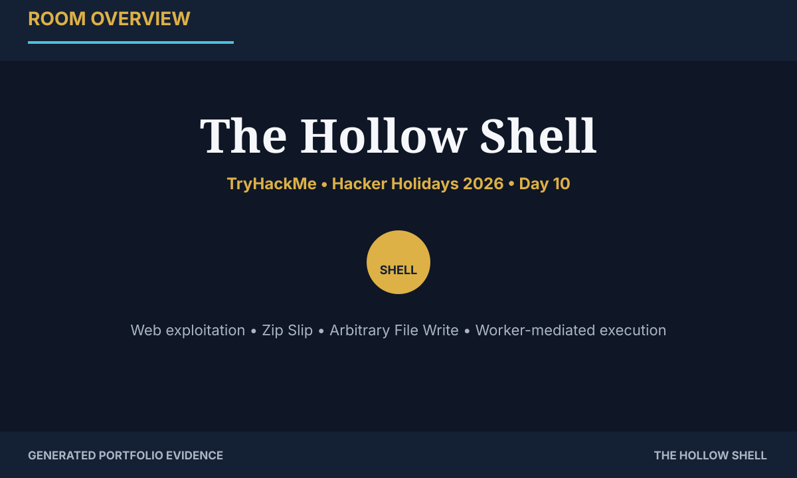
  <figcaption>Figure 01 — Challenge identity, scope, and exploitation theme.</figcaption>
</figure>

The challenge centers on the Byte Lotus hotel's Shoreline Display portal. The application accepts uploaded shell packages and provides clues about how uploaded content is processed.

The investigation focuses on the security implications of the upload and extraction pipeline rather than treating the final shell as the only meaningful outcome.

## Reconnaissance

<a id="reconnaissance"></a>

### Service discovery

The initial step is to identify the network services exposed by the target.

```bash
nmap TARGET_IP
```

The documented scan identifies the following services:

| Port | Service | Observation |
|---:|---|---|
| 22/tcp | SSH | Open |
| 5000/tcp | Web application | Open |

<figure>
  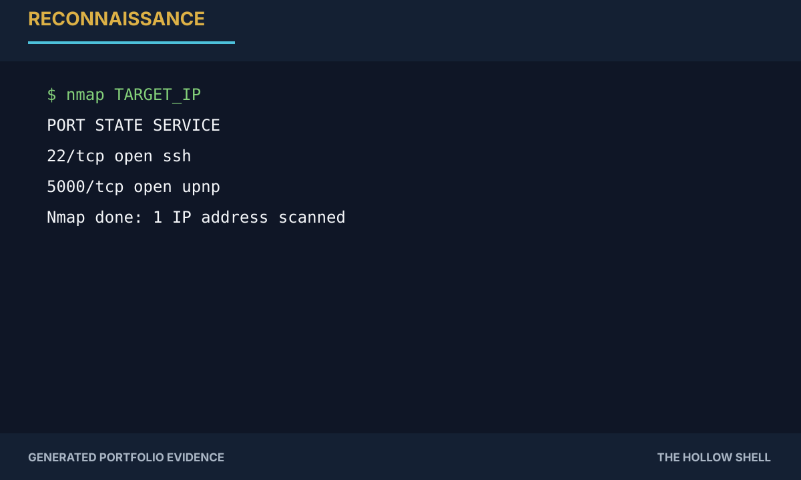
  <figcaption>Figure 02 — Initial service enumeration.</figcaption>
</figure>

**What the command does:** Nmap probes the specified target to identify reachable network services.

**Why it was used:** Establishing the exposed attack surface helps prioritize further investigation.

**What it revealed:** SSH and a web application were accessible on the documented ports.

**Why it matters:** TCP/5000 becomes the primary focus because the challenge's upload workflow is exposed through the web application.

The presence of SSH is relevant reconnaissance information, but the documented exploitation chain does not require SSH as the initial access mechanism.

## Upload Endpoint Discovery

<a id="upload-endpoint"></a>

Web-content enumeration identifies an interesting route:

```text
/upload
```

A direct request using `GET` produces:

```text
405 Method Not Allowed
```

<figure>
  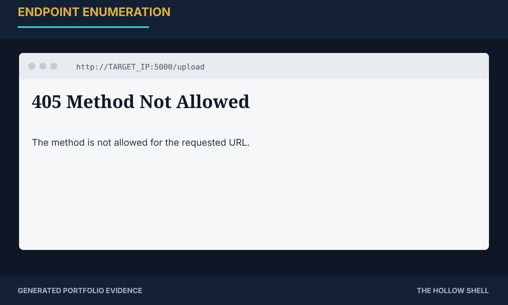
  <figcaption>Figure 03 — HTTP method analysis reveals a route that rejects the requested method.</figcaption>
</figure>

### Interpreting the response

An HTTP `405 Method Not Allowed` response indicates that the server does not permit the requested HTTP method for the identified resource.

This differs from a `404 Not Found` response, which indicates that the server could not find the requested resource or is not disclosing its existence.

In this investigation, the response provides a useful lead: `/upload` is associated with an upload workflow, and the method used for the initial request is not accepted.

The response alone does not prove every detail of the endpoint's behavior. The subsequent application analysis provides the context for identifying the upload functionality.

## Source Disclosure

<a id="source-disclosure"></a>

Inspection of the login page source reveals a lab-specific HTML comment containing the initial staff credential.

<figure>
  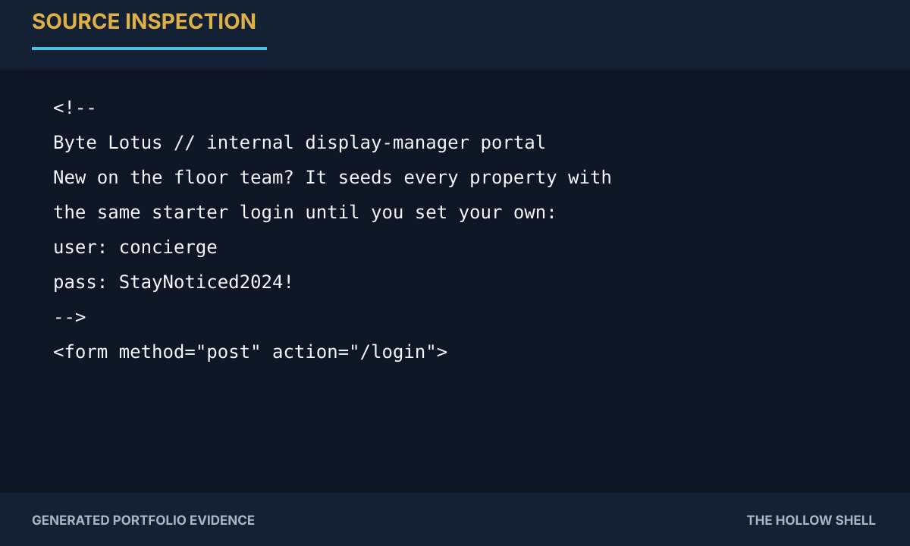
  <figcaption>Figure 04 — Client-visible source exposes the seeded staff credential.</figcaption>
</figure>

The credential documented in the original investigation is:

```text
concierge : StayNoticed2024!
```

The credential is preserved because it is part of the original challenge evidence.

### Security significance

HTML comments are not a secure location for secrets. A browser receives the page source and can expose its contents through developer tools or source inspection.

The same principle applies to:

- JavaScript delivered to the client.
- Hidden HTML fields.
- Embedded application configuration.
- Debug output.
- Source maps containing sensitive implementation details.

**Finding:** A credential embedded in client-delivered source can disclose authentication material to anyone able to retrieve that source.

**Defensive lesson:** Credentials, API secrets, and other authentication material must remain on the server side. Removing a secret from the visible page interface is insufficient if the value remains in the delivered source.

## Dashboard Enumeration

<a id="dashboard-enumeration"></a>

Authentication exposes the Shoreline Display staff dashboard.

<figure>
  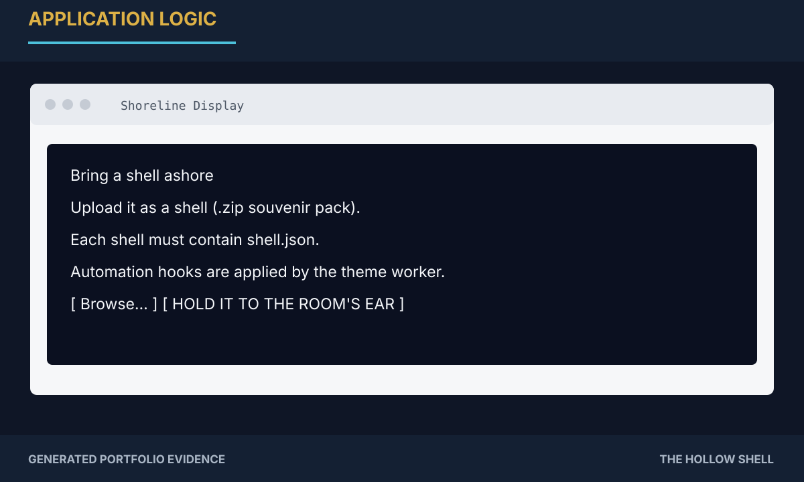
  <figcaption>Figure 05 — Authenticated upload interface and background-worker clue.</figcaption>
</figure>

The dashboard provides two important pieces of architectural information:

1. Uploaded shells are expected to contain a manifest named `shell.json`.
2. Shell packages may contain automation hooks that are processed by a theme worker.

These details establish a relationship between the upload functionality and a downstream automated processing component.

### Manifest format

The documented baseline manifest is:

```json
{
  "name": "test",
  "assets": []
}
```

The manifest represents the expected shell-package structure used in the investigation.

### Worker trust boundary

The reference to automation hooks is particularly important because a background worker may have filesystem access or execution capabilities beyond those available to an ordinary static-file handler.

If untrusted uploaded content can influence what the worker processes, the application must enforce a strict boundary between user-supplied data and trusted executable content.

The dashboard's wording is an investigative clue. The vulnerability and execution chain are documented in the subsequent stages.

## Baseline Upload

<a id="baseline-upload"></a>

Before investigating the extraction boundary, the original workflow establishes normal upload behavior with a benign ZIP archive.

<figure>
  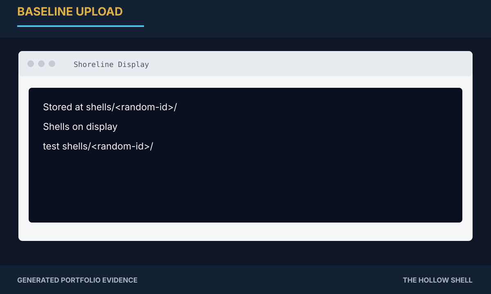
  <figcaption>Figure 06 — Normal shell upload establishes the expected application behavior.</figcaption>
</figure>

The application stores uploaded shells beneath a per-upload directory similar to:

```text
/shells/<random-id>/
```

This provides an expected filesystem boundary for subsequent validation.

### Why establish a baseline?

A baseline distinguishes normal application behavior from behavior introduced by a malformed or adversarial archive.

The comparison provides a structured investigation:

1. Observe the expected upload format.
2. Identify the expected extraction location.
3. Inspect how archive member paths are handled.
4. Determine whether a member can escape the intended directory.
5. Validate the resulting impact using controlled evidence.

The baseline is important because a successful upload alone does not establish the presence of a vulnerability.

## Zip Slip Discovery

<a id="zip-slip"></a>

### Vulnerability overview

Zip Slip is a path-traversal vulnerability involving archive extraction. It occurs when an application accepts archive member paths without adequately constraining their resolved destinations to the intended extraction directory.

A traversal-bearing filename such as:

```text
../marker.txt
```

can refer to a location outside the expected directory when path components are resolved.

<figure>
  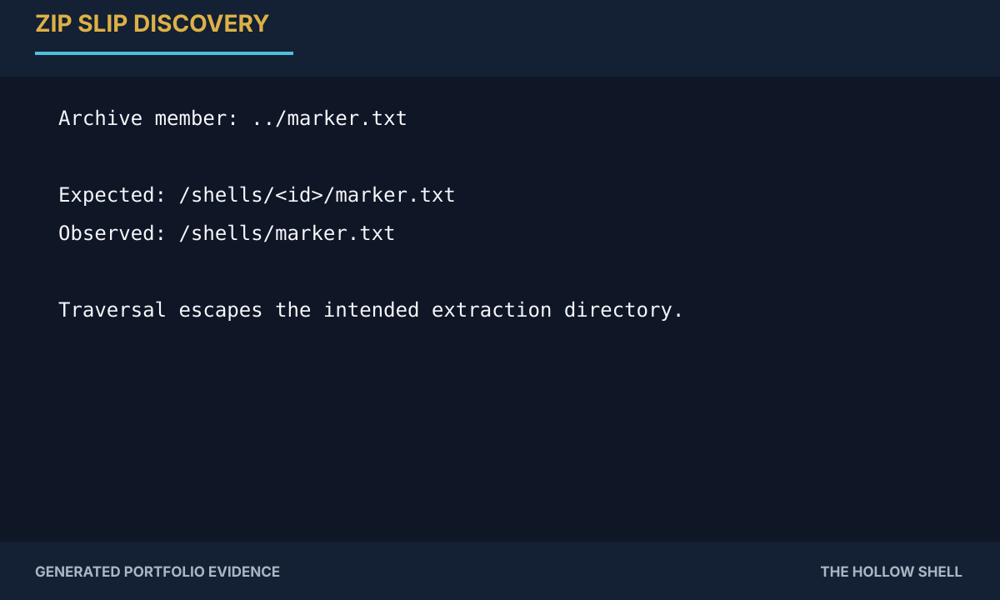
  <figcaption>Figure 07 — Marker-based evidence of archive traversal beyond the expected directory.</figcaption>
</figure>

### Filesystem boundary model

Consider the intended extraction directory:

```text
/shells/abc123/
```

A normal archive member might resolve to:

```text
/shells/abc123/file.txt
```

A traversal-bearing member might instead resolve to:

```text
/shells/abc123/../marker.txt
```

After path normalization, the destination is:

```text
/shells/marker.txt
```

The resulting path lies outside the original per-upload directory.

The exact destination depends on the extraction root and the archive member path. These examples illustrate the path-resolution issue documented in the investigation.

### Why this matters

An archive filename is untrusted input. The extraction process must not assume that a member belongs inside the upload directory simply because it appears in the archive.

**Finding:** The documented marker test confirms that archive extraction can escape its intended directory.

The marker-based test establishes the traversal behavior before the investigation proceeds to stronger evidence of file-write impact.

## Arbitrary File Write

<a id="arbitrary-file-write"></a>

A second validation demonstrates that the traversal weakness can place a controlled static asset outside the expected shell directory.

<figure>
  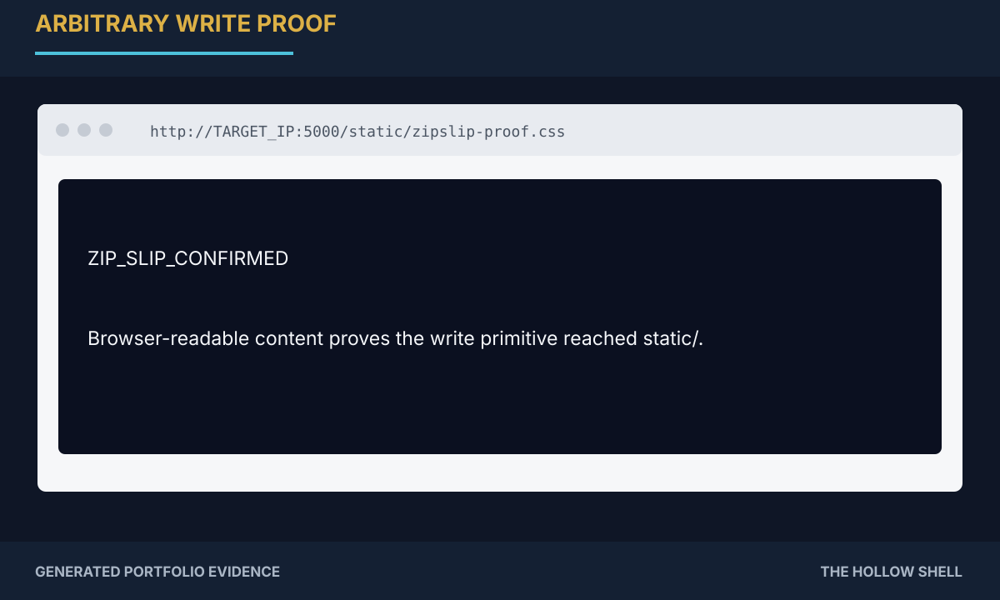
  <figcaption>Figure 08 — Static content provides evidence of a file written outside the expected extraction boundary.</figcaption>
</figure>

The documented sequence is:

```text
Attacker-controlled ZIP
          |
          v
Traversal-bearing archive member
          |
          v
Unsafe extraction
          |
          v
Extraction-boundary bypass
          |
          v
Arbitrary file write
          |
          v
Browser-readable artifact
```

### Why the second validation matters

A traversal-looking filename is not, by itself, proof that a write occurred outside the extraction root. The resulting filesystem artifact provides stronger evidence of the actual impact.

This staged validation distinguishes the vulnerable path-handling behavior from the resulting write primitive.

### Security impact

The application is no longer limited to placing uploaded files inside the intended shell directory. Depending on the application process's filesystem permissions, the same primitive may affect other writable locations.

The finding does not imply that every path on the host is writable. The effective impact remains constrained by operating-system permissions and the application's execution context.

## Worker Hook Analysis

<a id="worker-hook"></a>

The dashboard's automation-hook description provides the next investigative lead.

<figure>
  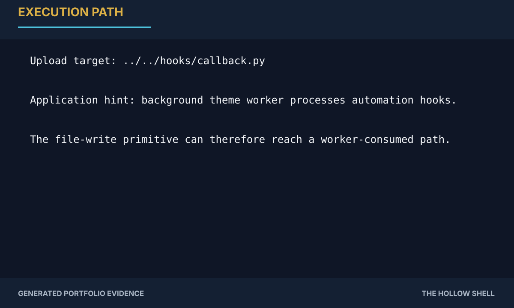
  <figcaption>Figure 09 — Evidence associated with the worker-controlled hook location.</figcaption>
</figure>

The exploitation hypothesis is that the archive traversal primitive can place a controlled file where the background worker processes automation hooks.

The documented relationship is:

```text
Zip Slip
   |
   v
Controlled file placement
   |
   v
Worker hook location
   |
   v
Worker processes hook
   |
   v
Execution impact
```

### Why the worker matters

An arbitrary file write is a filesystem primitive. It does not automatically mean remote code execution.

The impact increases when a separate trusted component consumes the written file as executable content or otherwise interprets it in a security-sensitive way.

The worker introduces this second boundary. If it processes attacker-controlled source files without sufficient validation or isolation, the upload vulnerability can become an execution path.

## Payload Archive

<a id="payload-archive"></a>

The original investigation documents a final ZIP archive containing the expected manifest and a callback file intended for the worker-controlled location.

<figure>
  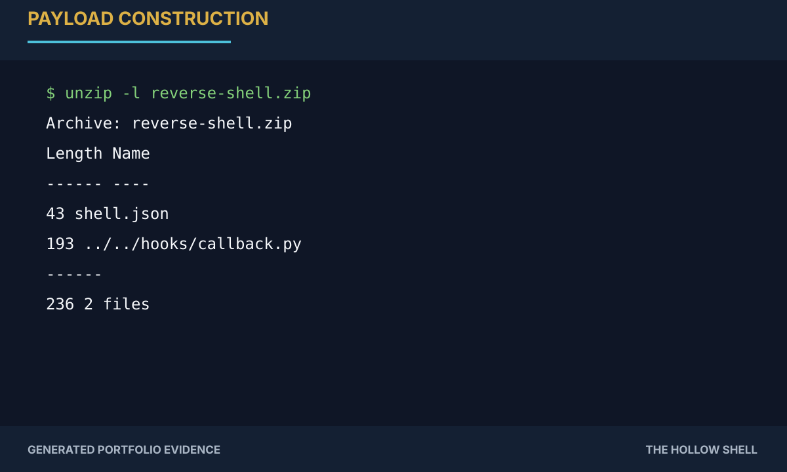
  <figcaption>Figure 10 — Archive structure associated with the documented execution chain.</figcaption>
</figure>

The conceptual archive structure is:

```text
reverse-shell.zip
├── shell.json
└── ../../hooks/callback.py
```

This is the structure documented in the original write-up. The actual destination depends on the application's extraction root and the worker's hook location.

The callback address is represented by the placeholder:

```text
YOUR_ATTACKER_IP
```

### Operational considerations

The original documentation emphasizes configuring the callback address before preparing the archive.

For security analysis, the significant point is not the callback address itself. It is the interaction between the archive extraction vulnerability and the worker's handling of the resulting file.

The public portfolio retains the documented archive structure and execution reasoning without claiming additional payload details or environmental configuration that were not included in the source material.

## Shell Access and Objective

<a id="shell-and-objective"></a>

The documented investigation reports that the worker processes the planted callback and a listener receives a shell in the application context.

The resulting user is:

```text
roomservice
```

The challenge objective is located at:

```text
/home/roomservice/flag.txt
```

<figure>
  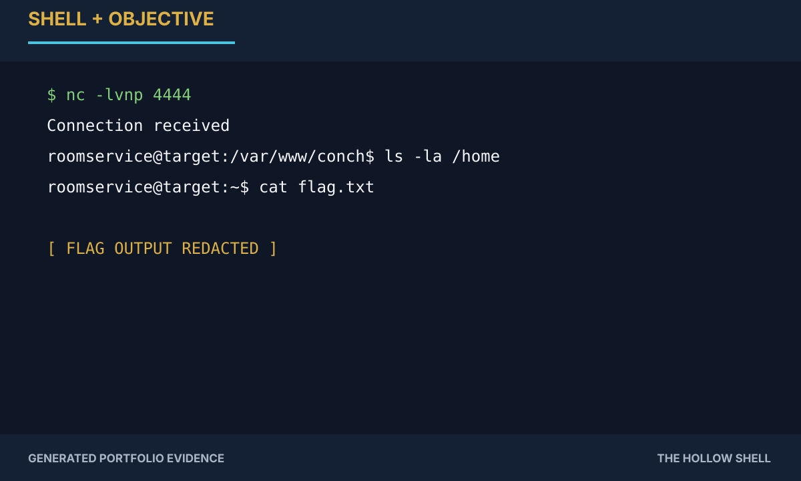
  <figcaption>Figure 11 — Documented post-exploitation context. The final flag output remains intentionally redacted.</figcaption>
</figure>

The public documentation preserves the user context and objective path while omitting the final flag value.

### Result

The documented outcome demonstrates how an upload feature can become a remote-code-execution path when multiple weaknesses interact:

- A client-visible credential disclosure assists authentication.
- Unsafe archive extraction permits traversal outside the intended directory.
- The resulting arbitrary file-write primitive reaches a worker-controlled location.
- The worker processes attacker-influenced content.
- The chain culminates in shell access as `roomservice`.

The final flag remains excluded from this portfolio edition.

## Technical Analysis

<a id="technical-analysis"></a>

### 1. Zip Slip

Zip Slip occurs when an archive extractor trusts member paths without ensuring that the final resolved destination remains inside the permitted extraction root.

The vulnerable conceptual flow is:

```text
Extraction root
      +
Untrusted archive filename
      |
      v
Destination path
      |
      v
Filesystem write
```

If the application does not validate the canonical destination, traversal components can redirect the write outside the expected directory.

A secure extractor should enforce the invariant:

```text
canonical(destination) is contained within extraction_root
```

This validation must be applied before writing each archive member.

It should also account for platform-specific path separators, absolute paths, symbolic links, and filesystem behavior that could undermine a simple string-prefix check.

### 2. Arbitrary File Write

The Zip Slip weakness changes the security properties of the upload feature.

The intended capability is:

```text
User can upload a shell package.
```

The documented vulnerable behavior becomes:

```text
User can influence filesystem destinations
outside the intended extraction directory.
```

The effective scope depends on the permissions of the process performing extraction.

This distinction matters because an arbitrary file-write primitive can affect application configuration, worker inputs, or other sensitive locations if those locations are writable by the vulnerable process.

### 3. Worker-Mediated Execution

The background worker introduces a downstream trust boundary:

```text
Untrusted upload
      |
      v
Filesystem
      |
      v
Trusted worker
```

If the worker interprets attacker-controlled source files as executable hooks, a file-write primitive can become code execution.

The primary design failure is the combination of insufficient filesystem confinement and unsafe downstream processing. Fixing only the upload interface would not necessarily address the worker's independent trust assumptions.

### 4. Credential Disclosure

The login page source contains the documented lab credential:

```text
concierge : StayNoticed2024!
```

The disclosure is a separate security issue from Zip Slip. It reduces the protection provided by the authentication boundary because the credential is available in client-delivered content.

The appropriate fix is to remove the secret from the page source and rotate the affected credential where necessary.

### 5. Vulnerability Chaining

The impact of the challenge comes from the interaction between multiple weaknesses rather than from the ZIP extraction flaw in isolation.

```text
Credential disclosure
        |
        v
Authenticated application access
        |
        v
ZIP upload
        |
        v
Unsafe extraction
        |
        v
Arbitrary file write
        |
        v
Worker hook processing
        |
        v
Code execution
        |
        v
Shell access
```

The key distinction is between an individual weakness and the complete attack path. The arbitrary file write becomes substantially more serious because a trusted automated component can consume the resulting file.

## Exploitation Chain

<a id="exploitation-chain"></a>

<div class="attack-chain">
  <div class="attack-step">Source Disclosure</div>
  <div class="attack-arrow">→</div>
  <div class="attack-step">Authenticated Access</div>
  <div class="attack-arrow">→</div>
  <div class="attack-step">ZIP Upload</div>
  <div class="attack-arrow">→</div>
  <div class="attack-step">Unsafe Extraction</div>
  <div class="attack-arrow">→</div>
  <div class="attack-step">Zip Slip</div>
  <div class="attack-arrow">→</div>
  <div class="attack-step">Arbitrary Write</div>
  <div class="attack-arrow">→</div>
  <div class="attack-step">Worker Processing</div>
  <div class="attack-arrow">→</div>
  <div class="attack-step">Code Execution</div>
  <div class="attack-arrow">→</div>
  <div class="attack-step">roomservice</div>
</div>

The documented chain highlights three distinct security boundaries:

1. **Authentication boundary:** Client-visible credentials undermine the intended secrecy of the login process.
2. **Filesystem boundary:** Unsafe archive extraction allows a write outside the intended directory.
3. **Execution boundary:** The worker processes attacker-influenced content in a trusted context.

A complete remediation strategy must address all three boundaries.

## Investigation Methodology

<a id="methodology"></a>

The investigation is best understood as a sequence of increasingly strong validations.

### Stage 1 — Discover

- Identify exposed network services.
- Find the web application and interesting routes.
- Investigate the upload endpoint's HTTP method behavior.
- Identify the authentication surface.

### Stage 2 — Understand

- Inspect client-visible source.
- Identify the documented lab credential.
- Authenticate to the staff dashboard.
- Read the manifest requirements and worker-related hints.
- Establish the expected upload directory.

### Stage 3 — Validate

- Establish normal ZIP upload behavior.
- Investigate archive member path handling.
- Use a harmless marker to test the extraction boundary.
- Confirm the resulting static-file write.

### Stage 4 — Analyze the execution boundary

- Investigate the dashboard's worker-hook behavior.
- Relate the file-write primitive to the downstream consumer.
- Review the documented callback and shell evidence.

### Stage 5 — Document and defend

- Preserve evidence for each stage.
- Explain the root cause and impact.
- Identify relevant detection opportunities.
- Recommend controls that address the underlying trust boundaries.

This methodology separates discovery, validation, impact assessment, and remediation. It also avoids treating a single successful request as proof of the entire exploitation chain.

## Root Cause Analysis

<a id="root-cause"></a>

The primary root cause is insufficient validation of archive member paths during extraction.

The application trusts paths supplied by the ZIP archive instead of ensuring that each resolved destination remains inside the authorized extraction directory.

The secondary design weakness is the relationship between uploaded content and the background worker.

| Component | Design weakness | Security consequence |
|---|---|---|
| Login page | Credential included in client-visible source | Authentication material disclosure |
| ZIP extractor | Archive paths not sufficiently constrained | Path traversal |
| Filesystem | Writes permitted outside the expected extraction directory | Arbitrary file placement within the process's permissions |
| Worker | Attacker-influenced files reach automated processing | Potential execution of untrusted content |
| Application process | Excessive permissions would enlarge the impact | Greater potential filesystem and process compromise |

The primary lesson is that upload validation, filesystem confinement, and worker isolation must be designed as complementary controls.

## Security Findings and Impact

<a id="security-findings"></a>

The following findings summarize the issues documented in the original investigation. No CVE identifiers or numerical severity ratings are assigned because the source documentation does not establish them.

| Finding | Evidence described in the source | Impact |
|---|---|---|
| Client-side credential disclosure | Login page source exposes the lab credential | Credential exposure and weakened authentication secrecy |
| Zip Slip / path traversal | Harmless traversal-marker test | Escape from the intended extraction directory |
| Arbitrary file write | Browser-readable static artifact | Attacker-controlled file placement, subject to process permissions |
| Unsafe worker trust boundary | Dashboard worker clue and hook-placement evidence | Potential execution of attacker-influenced content |
| Remote code execution | Documented worker-mediated callback and shell outcome | Shell access as `roomservice` |

<div class="key-finding">
  <div class="key-finding-title">Impact Summary</div>

  The documented chain progresses from information disclosure and unsafe file handling to arbitrary file write and worker-mediated execution. The reported end state is a shell under the `roomservice` account, with the challenge objective at `/home/roomservice/flag.txt`.
</div>

## Security Recommendations

<a id="remediation"></a>

### 1. Enforce extraction-root boundaries

Canonicalize every archive member's destination and verify that it remains inside the authorized extraction directory before writing.

Reject unsafe absolute paths, traversal components, and symbolic-link behavior that could bypass the boundary. Validation should use filesystem-aware path handling rather than relying only on string comparisons.

**Finding → Risk → Control**

```text
Zip Slip
    |
    v
Filesystem boundary bypass
    |
    v
Canonical path validation
+ confined extraction
```

### 2. Separate uploaded data from executable code

Store uploaded content in a dedicated location that is not part of the application code tree and is not automatically treated as executable content.

Prefer a design in which uploads are handled as validated data rather than as code or executable hooks.

```text
Untrusted upload
       |
       v
Isolated data storage
       |
       v
Validated processing
```

### 3. Do not execute uploaded source

The worker should consume a strict, documented data format instead of executing arbitrary files supplied through the upload interface.

If automation is required, use an allowlisted set of predefined operations with explicit validation and authorization.

### 4. Apply least privilege

Run the web application and worker under separate, minimally privileged accounts where practical.

Restrict filesystem write access, process execution, and network access to what each component requires. The worker should not be able to modify sensitive application files simply because it processes uploaded content.

### 5. Remove client-visible secrets

Remove credentials from HTML comments, JavaScript, embedded configuration, and other browser-delivered resources.

Rotate exposed credentials and use appropriate server-side secret management. Authentication secrets should never depend on the obscurity of page source.

### 6. Monitor filesystem boundaries

Record and alert on unexpected writes outside the designated upload directory.

Useful monitoring includes:

- Unexpected modifications to application files.
- New source files in worker-controlled directories.
- Archive members containing traversal patterns.
- Worker activity involving files created by the upload service.

### 7. Restrict worker execution behavior

Constrain which file types and operations the worker can process. Where feasible, isolate worker execution and restrict outbound network connections to the destinations necessary for its legitimate function.

### 8. Add regression tests

Create automated tests for archive members containing:

- Parent-directory traversal.
- Absolute paths.
- Alternate path separators.
- Symbolic links.
- Nested paths that resolve outside the extraction root.

Verify that rejected entries cannot create files outside the permitted directory.

## Detection Opportunities

<a id="detection"></a>

The documented attack chain suggests several useful defensive monitoring signals.

| Signal | Possible interpretation | Defensive response |
|---|---|---|
| `../` or equivalent traversal patterns in archive members | Possible Zip Slip attempt | Reject the archive entry and record the event |
| Absolute paths in archive entries | Attempt to escape the extraction boundary | Validate and reject unsafe paths |
| Writes outside the upload root | Potential path traversal or arbitrary file write | Investigate the originating request and process |
| Unexpected `.py` files in worker directories | Possible execution staging | Validate the file's origin and worker activity |
| Web or worker processes spawning shell interpreters unexpectedly | Potential command or code execution | Correlate process telemetry with upload events |
| Unexpected outbound TCP connections | Possible callback or reverse-shell activity | Investigate destination, process ancestry, and timing |
| Worker-created child processes outside normal behavior | Possible execution of untrusted content | Review worker inputs and process activity |
| Application files modified following an upload | Possible archive traversal | Preserve filesystem and request evidence |

These signals are detection opportunities, not proof of compromise in isolation. Correlating upload events, filesystem changes, worker activity, and outbound connections provides a stronger basis for investigation.

## Lessons Learned

<a id="lessons-learned"></a>

### 01 — HTTP errors can reveal application structure

A `405 Method Not Allowed` response can provide useful evidence that a route rejects the requested method. It is a lead for further investigation, not proof of every endpoint capability.

### 02 — Client-delivered source is part of the attack surface

HTML comments and other browser-visible content should never be treated as secret storage.

### 03 — Archive member paths are untrusted input

Extractors must enforce filesystem boundaries for every member rather than trusting the archive's directory structure.

### 04 — Validate primitives incrementally

A harmless traversal marker and a static-file proof provide clearer evidence than jumping directly to an execution attempt.

### 05 — Arbitrary file write is not automatically code execution

The impact depends on which destinations are writable and whether another component interprets the resulting files in a security-sensitive way.

### 06 — Downstream consumers can amplify vulnerabilities

A background worker may transform a file-write issue into an execution path when it processes attacker-controlled content.

### 07 — Application hints can reveal trust boundaries

The dashboard's automation-hook description provided a lead for investigating how uploaded files were consumed after extraction.

### 08 — Good documentation explains the evidence

A strong technical write-up should answer:

- What was discovered?
- Why did the finding matter?
- What did the test demonstrate?
- What evidence supports the conclusion?
- How did the weaknesses combine?
- Which controls would prevent recurrence?

## Skills and Tools

<a id="skills-and-tools"></a>

The original documentation identifies the following tools and technical skills.

### Tools

| Tool | Documented purpose |
|---|---|
| Nmap | Initial network-service enumeration |
| Gobuster | Web-content enumeration |
| Netcat | Listener associated with the documented shell workflow |
| Python | Listed among the investigation's technical skills |

### Technical skills demonstrated

<div class="tool-list">
  <span class="tool-tag">Network Reconnaissance</span>
  <span class="tool-tag">HTTP Analysis</span>
  <span class="tool-tag">HTML Source Inspection</span>
  <span class="tool-tag">Web Enumeration</span>
  <span class="tool-tag">ZIP Analysis</span>
  <span class="tool-tag">Path Traversal</span>
  <span class="tool-tag">Zip Slip</span>
  <span class="tool-tag">Arbitrary File Write</span>
  <span class="tool-tag">Worker Trust Boundaries</span>
  <span class="tool-tag">Linux</span>
  <span class="tool-tag">Web Exploitation</span>
  <span class="tool-tag">Security Remediation</span>
</div>

These skills reflect the activities described in the original write-up. The tools are not presented as an independently verified execution log.

## Evidence and Repository Structure

<a id="repository-structure"></a>

The original documentation describes the following repository layout. It is retained here as a reference to the existing project structure.

```text
The-Hollow-Shell-TryHackMe-Walkthrough/
├── README.md
├── Documentation/
│   ├── Documentation.md
│   └── Documentation.docx
├── Resources/
│   └── notes.md
├── Screenshots/
│   └── README.md
├── docs/
│   ├── index.md
│   └── assets/
│       ├── 01-cover.svg
│       ├── 02-recon-nmap.svg
│       ├── 03-upload-method.svg
│       ├── 04-source-disclosure.svg
│       ├── 05-dashboard-upload.svg
│       ├── 06-test-upload.svg
│       ├── 07-zipslip-marker.svg
│       ├── 08-zipslip-static-proof.svg
│       ├── 09-hook-write.svg
│       ├── 10-payload-archive.svg
│       ├── 11-shell-flag-redacted.svg
│       └── css/
│           └── custom.scss
└── _config.yml
```

The SVG filenames and image references in this document remain unchanged. The three permanent master files for the shared portfolio architecture are not being regenerated here.

The repository tree is reproduced from the original documentation; it does not assert that every listed file has been independently checked for existence.

## Related Documentation

<a id="related-documentation"></a>

### Full technical report

[`Documentation/Documentation.md`](../Documentation/Documentation.md)

The detailed report is described as containing the investigation, exploitation reasoning, evidence mapping, remediation, and detection analysis.

### Research notes

[`Resources/notes.md`](../Resources/notes.md)

The research notes are described as containing technical observations, troubleshooting, investigation reasoning, and defensive analysis.

### Word report

[`Documentation/Documentation.docx`](../Documentation/Documentation.docx)

The formatted Word version of the technical report.

### Repository README

[`README.md`](../README.md)

The repository landing page provides the shorter portfolio overview.

## Portfolio Takeaway

The value of this challenge lies in understanding how multiple weaknesses interact.

```text
Enumerate
    |
    v
Understand the application
    |
    v
Identify trust boundaries
    |
    v
Establish baseline behavior
    |
    v
Validate the vulnerability
    |
    v
Demonstrate file-write impact
    |
    v
Analyze worker processing
    |
    v
Document the execution outcome
    |
    v
Explain root cause
    |
    v
Recommend defensive controls
```

The Hollow Shell demonstrates the risk created by the combination of:

```text
Untrusted archive paths
          +
Unsafe extraction
          +
Arbitrary file write
          +
Trusted worker processing
```

A professional security assessment must establish each step with evidence and distinguish the underlying vulnerability from its downstream impact.

## Flag Policy

<a id="flag-policy"></a>

The final flag is intentionally excluded from this public portfolio document.

The documented objective is:

```text
/home/roomservice/flag.txt
```

The output is represented as:

```text
[ FLAG OUTPUT REDACTED ]
```

This policy keeps the repository focused on methodology, technical understanding, evidence, and defensive learning rather than functioning as a direct challenge-answer repository.

## Responsible Use

<a id="responsible-use"></a>

This documentation concerns an intentionally vulnerable TryHackMe training environment.

The techniques described should only be reproduced against:

- Systems you own.
- Systems for which you have explicit authorization.
- Intentionally vulnerable training environments.

Do not apply these techniques to production systems without authorization. File-upload and archive-extraction testing should be performed in a controlled environment with appropriate safeguards.

## References

<a id="references"></a>

- [TryHackMe — The Hollow Shell](https://tryhackme.com/room/hh-thehollowshell-ddb582ac)
- [OWASP — Path Traversal](https://owasp.org/www-community/attacks/Path_Traversal)
- [OWASP — File Upload Cheat Sheet](https://cheatsheetseries.owasp.org/cheatsheets/File_Upload_Cheat_Sheet.html)
- [Reference walkthrough — Crystalcascade14](https://crystalcascade14.medium.com/the-hollow-shell-9d9c1946d6f2)

The original documentation describes the room as a 90-point, Medium-difficulty Web challenge in Hacker Holidays 2026.

The referenced independent walkthrough is retained as a supplementary source. No additional CVE, advisory, or external technical reference has been introduced.

